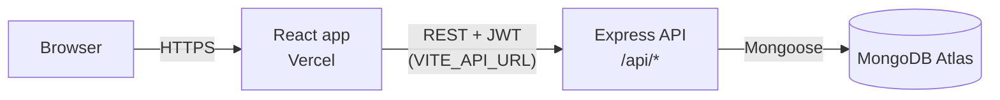

# eTutor: Smart Tutoring Platform

A full-stack MERN web application that connects students with tutors. Students discover tutors and book sessions, tutors manage their courses and bookings, and administrators oversee the whole platform.

| | |
|---|---|
| **Live application** | https://smart-tutoring-platform-using-mern.vercel.app/ |
| **Backend API** | https://smart-tutoring-platform.bonto.run/api |
| **API health check** | https://smart-tutoring-platform.bonto.run/api/health |


---

## 1. Overview

Finding a reliable tutor and scheduling sessions is usually done through informal channels. eTutor puts this on one platform with three role-based experiences:

- **Students** browse tutors and courses, book one-on-one sessions and track their session history.
- **Tutors** publish and manage their own courses, review incoming bookings, and see their reviews.
- **Admins** manage users, tutors, courses and bookings, view earnings analytics and read contact-form messages.

## 2. Key features

| Area | What it does |
|---|---|
| Authentication | Sign up and log in with JWT (7-day expiry); passwords hashed with bcrypt |
| Role-based access | Separate student, tutor and admin areas, enforced in both the UI and the API |
| Tutor discovery | Search and filter tutors by subject, city and availability; view tutor profiles and reviews |
| Booking | Choose date, time, subject and session type (online / in-person); the price comes from the tutor's rate |
| Course management | Tutors create, edit and delete their own courses; admins can manage all courses |
| Admin tools | User and tutor management (suspend/activate, delete), bookings overview, earnings charts, contact inbox |
| Contact form | Messages are stored in MongoDB and visible to admins |

## 3. Technology stack

| Layer | Technology |
|---|---|
| Frontend | React 19, TypeScript, Vite, React Router 7, Recharts |
| Backend | Node.js, Express 5, Mongoose |
| Database | MongoDB Atlas |
| Security | JWT, bcryptjs, helmet, CORS allow-list, login rate limiting |
| Hosting | Frontend on Vercel, backend API on a Node host (see Section 8) |

## 4. Architecture



The frontend reads the backend address from a single environment variable, `VITE_API_URL`, handled in `src/api/api.ts`. If it is not set (local development) it falls back to `http://localhost:5000/api`. The client always produces exactly one `/api` segment, so a path such as `/auth/register` becomes `https://smart-tutoring-platform.bonto.run/api/auth/register`.

### Project structure

```
├── src/                     # React frontend
│   ├── api/api.ts           # API base URL + fetch wrapper (adds JWT, handles expiry)
│   ├── context/             # AuthContext (session state)
│   ├── components/          # Navbar, Hero, Stats, RequireRole (route guard), admin widgets
│   └── pages/               # Home, Login, Signup, dashboards, booking, admin pages
├── backend/
│   ├── server.js            # Express app, CORS, helmet, rate limiting
│   ├── middleware/auth.js   # JWT verification and role checks
│   ├── models/              # User, Course, Booking, Review, Contact
│   ├── routes/              # auth, users, courses, bookings, reviews, contact
│   └── seed.js              # Demo accounts and sample data
├── vercel.json              # SPA routing rewrite
└── .env.example             # Frontend environment variable template
```

## 5. Data model

| Collection | Main fields |
|---|---|
| **User** | name, email, hashed password, role (`student` / `tutor` / `admin`), subject, city, price, rating, status |
| **Course** | title, tutor → User, subject, level, price, description, status |
| **Booking** | student → User, tutor → User, course, subject, date, time, sessionType, amount, status (`Pending` / `Confirmed` / `Completed` / `Cancelled`) |
| **Review** | student → User, tutor → User, rating (1–5), comment |
| **Contact** | name, email, subject, message |

## 6. API reference

All routes are under `/api`.

| Endpoint | Access | Description |
|---|---|---|
| `POST /auth/register` | Public | Create a student or tutor account (admin accounts cannot be self-registered) |
| `POST /auth/login` | Public | Log in, returns a JWT and the user |
| `PUT /auth/change-password` | Logged in | Change own password |
| `GET /users`, `GET /users/:id` | Public | Tutor listing and profiles; email and phone are hidden except for the owner and admins |
| `PUT /users/:id` | Owner (limited fields) or admin | Update a profile |
| `POST /users`, `DELETE /users/:id` | Admin | Create or delete users |
| `GET /courses`, `GET /courses/:id` | Public | Browse courses |
| `POST /courses`, `PUT/DELETE /courses/:id` | Tutor (own) or admin | Manage courses |
| `GET /bookings` | Logged in | Own bookings; admins receive all |
| `POST /bookings` | Logged in | Create a booking (student is always the logged-in user) |
| `PUT/DELETE /bookings/:id` | Participant or admin | Update status or cancel |
| `GET /reviews`, `GET /reviews/tutor/:id` | Public | Read reviews |
| `POST /reviews` | Logged in | Submit a review |
| `POST /contact` | Public | Send a message |
| `GET /contact` | Admin | Read messages |
| `GET /health` | Public | Health check |

## 7. Security measures

- Passwords are hashed with bcrypt; plaintext passwords are never stored or returned.
- Every protected API route verifies the JWT; role checks (`requireRole`) restrict admin and tutor actions.
- Self-registration can only create `student` or `tutor` accounts; the role is validated on the server.
- Profile updates use field allow-lists, so a user cannot change their own role or status.
- Users only see their own bookings; admins see all.
- Public user listings hide email addresses and phone numbers.
- CORS allows only the configured frontend origin(s); helmet sets secure HTTP headers; login and signup are rate limited.
- The frontend guards dashboards by role and signs the user out when a token expires.
- Email-only password reset is intentionally disabled because it would allow account takeover; it would need an emailed one-time link.

**Testing:** the access rules were checked with an automated script (22 checks against a stubbed database) covering anonymous, student and tutor access to protected routes, rejection of forged tokens, forced `student` role on signup, password hashing, and the disabled password reset. All checks passed.

## 8. Setup and deployment

### Run locally

```bash
# Backend
cd backend
cp .env.example .env      # set MONGO_URI and a long random JWT_SECRET
npm install
npm run seed              # optional: demo accounts and sample data
npm run dev               # http://localhost:5000

# Frontend (new terminal, project root)
npm install
npm run dev               # http://localhost:5173  (uses http://localhost:5000/api by default)
```

### Environment variables

**Frontend (Vercel)**

| Name | Value |
|---|---|
| `VITE_API_URL` | `https://smart-tutoring-platform.bonto.run/api` |

**Backend**

| Name | Purpose |
|---|---|
| `MONGO_URI` | MongoDB Atlas connection string |
| `JWT_SECRET` | Long random string (32+ characters) used to sign tokens |
| `CLIENT_URL` | Allowed frontend origin: `https://smart-tutoring-platform-using-mern.vercel.app` (comma-separate multiple origins) |
| `PORT` | Optional; set automatically by most hosts |

### Deployment steps

1. **Database:** create a MongoDB Atlas cluster and database user; allow the backend host in Network Access.
2. **Backend:** deploy the `backend` folder (`npm install`, start with `npm start`) and set the backend variables above.
3. **Frontend:** import the repository into Vercel (build `npm run build`, output `dist`) and set `VITE_API_URL`. `vercel.json` rewrites all routes to `index.html` so deep links and page refreshes work.
4. **Seed (optional):** run `npm run seed` once against the production database to create demo data.

> After changing `VITE_API_URL` in Vercel, redeploy the frontend, because Vite embeds environment variables at build time.

## 9. Demo accounts

Created by `npm run seed` (password `Demo@12345`). Change or delete these before any real-world use.

| Role | Email |
|---|---|
| Admin | admin@etutor.demo |
| Student | student@etutor.demo |
| Tutor | ayesha@etutor.demo |

## 10. Limitations and future work

- Password reset by email is not implemented.
- Payments are not integrated; prices are displayed only.
- The student "My Courses" page currently shows sample data.
- Planned: email notifications, real-time chat, online payments, tutor availability calendars, and automated end-to-end tests.
